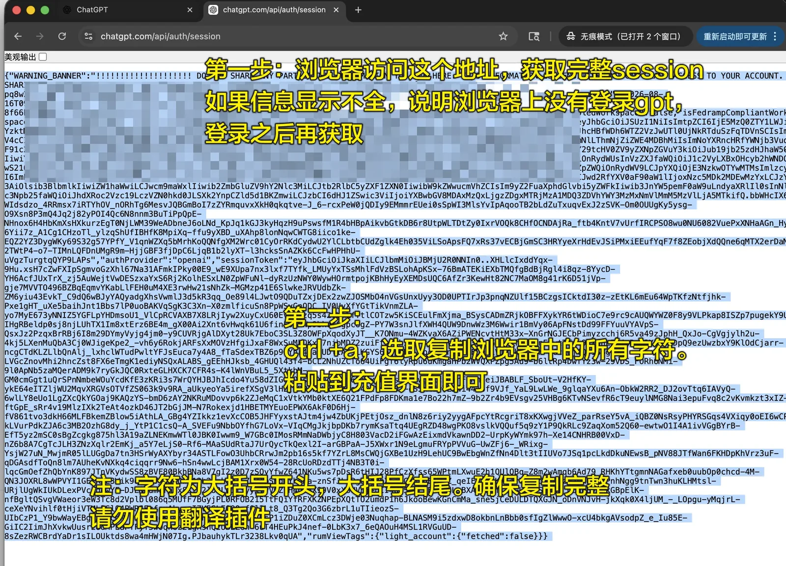
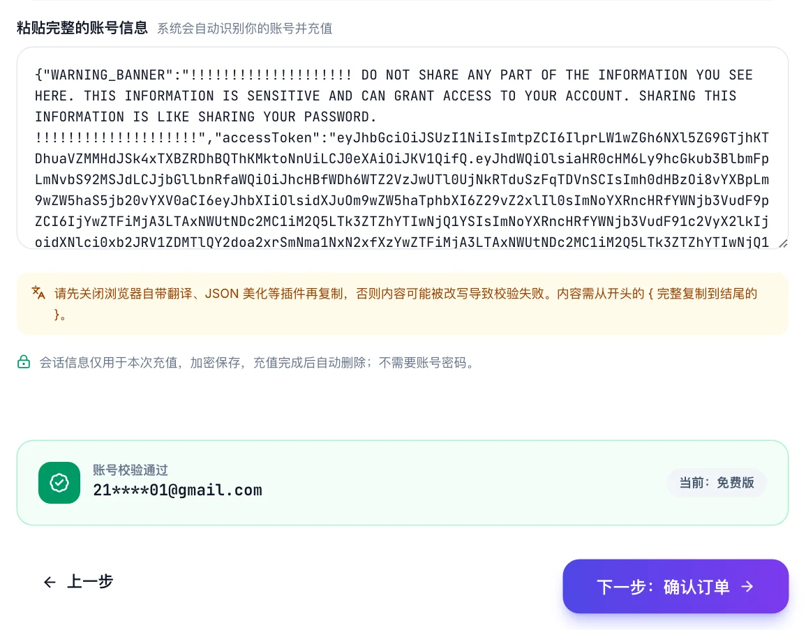
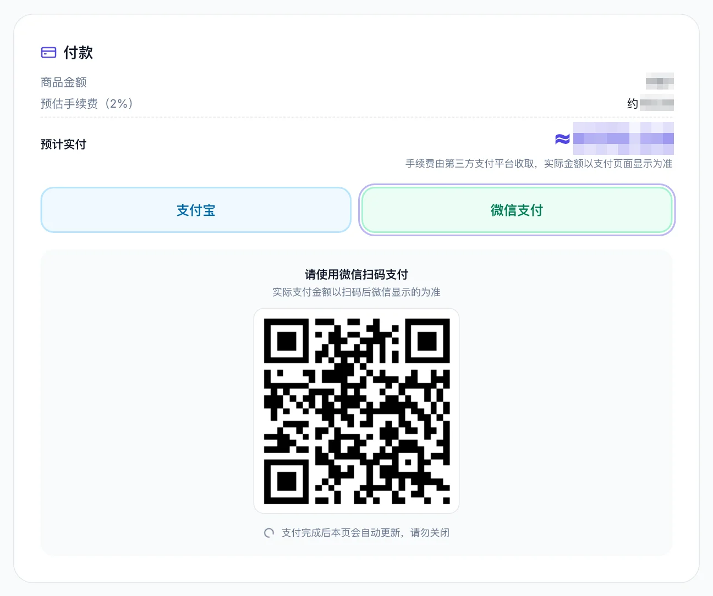
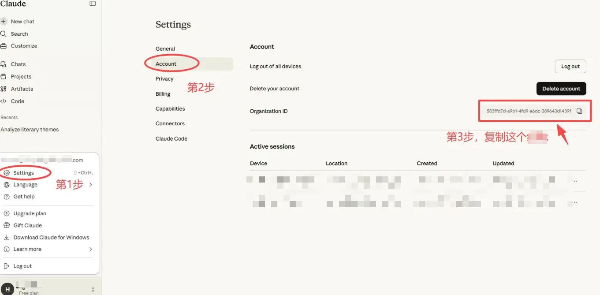
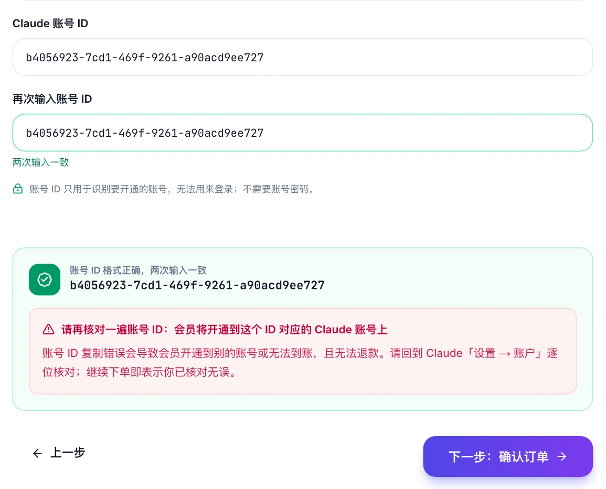
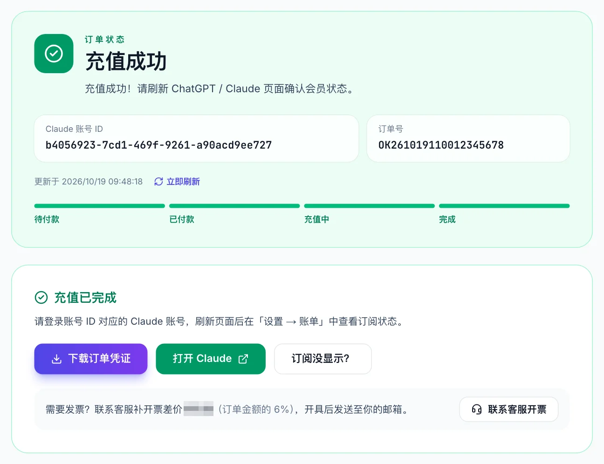

# ChatGPT Plus 国内开通指南（2026）：支付宝 / 微信 3 分钟自助充值，附海外卡、礼品卡、代充对比

> 最后更新：2026 年 10 月 20 日（北京时间）· 本次核对了 OpenAI 官方套餐价格、ChatGPT Plus / Pro 的人民币开通价，并把自助充值流程的 7 张截图全部换成 10 月最新界面。价格或入口有变化会在这里更新，可以点右上角 **Watch** 收到通知；发现过期内容欢迎提 Issue。

没有海外信用卡，国内想开 ChatGPT Plus 或 Claude Pro，2026 年真正可行的路只有几条。这篇文章把每条路的**真实成本、操作门槛和风险**讲清楚，并给出一条我们自己每天在用的路线：**用支付宝或微信付款，粘贴一段账号信息，几分钟后 Plus 直接开在你自己的账号上，不需要密码、不换号、不装任何软件。**

文中四条路线都如实写出优缺点，按你的设备和付款条件自己选。实测部分用的是我们自己在用的平台，商业关系在文末「关于本文」里有说明。

> [!TIP]
> **不想折腾海外卡、礼品卡、美区 ID？**
> 直接用 **支付宝 / 微信** 付款，粘贴一段账号信息，**3 分钟** Plus 开在你自己的账号上。不要密码、不换号、安卓 iPhone 都能用，不成功原路退款。
>
> **👉 [okai66.com — ChatGPT Plus / Pro、Claude Pro 自助开通](https://okai66.com/?utm_source=github&utm_medium=readme&utm_campaign=plus-guide-top)**
>
> 具体操作见下文 [实测截图](#实测支付宝--微信自助充值-chatgpt-plus附截图)；想先了解其它方式再决定，往下看四条路线对比。

---

## 目录

- [30 秒结论：按你是谁，直接选](#30-秒结论按你是谁直接选)
- [为什么国内开 Plus 这么难](#为什么国内开-plus-这么难)
- [2026 年 ChatGPT 套餐与价格](#2026-年-chatgpt-套餐与价格)
- [四条路线，逐条讲成本与风险](#四条路线逐条讲成本与风险)
  - [路线 A：官方直付](#路线-a官方直付有海外卡就选它)
  - [路线 B：海外虚拟信用卡](#路线-b海外虚拟信用卡成功率越来越低)
  - [路线 C：美区 Apple 礼品卡 + iPhone](#路线-c美区-apple-礼品卡--iphone-订阅门槛高但完全自助)
  - [路线 D：第三方代充](#路线-d第三方代充最省事但要会挑)
- [实测：支付宝 / 微信自助充值 ChatGPT Plus（附截图）](#实测支付宝--微信自助充值-chatgpt-plus附截图)
- [Claude Pro 同样可以：只需要账号 ID](#claude-pro-同样可以只需要账号-id)
- [一张表对比四条路线](#一张表对比四条路线)
- [掉订阅 ≠ 封号](#掉订阅--封号)
- [怎么挑一个靠谱的代充（5 条硬指标）](#怎么挑一个靠谱的代充5-条硬指标)
- [充完之后要知道的几件事](#充完之后要知道的几件事)
- [常见问题 FAQ](#常见问题-faq)
- [卡在哪一步就看哪一段：自助排查](#卡在哪一步就看哪一段自助排查)
- [一句话总结](#一句话总结)

---

## 30 秒结论：按你是谁，直接选

| 你的情况 | 推荐路线 |
|---|---|
| 手里有能用的 Visa / Master 海外卡，账单地址在海外 | **路线 A 官方直付**，最省钱最正规 |
| 有 iPhone，愿意折腾美区 Apple ID，想完全自己动手 | **路线 C 礼品卡**，一次搞定后续续费也方便 |
| 没有海外卡、不想折腾、只想几分钟用上 Plus | **路线 D 代充**，选支持「自助下单 + 不要密码 + 不成功退款」的平台 |
| 要开 Claude Pro | 目前只有代充能用人民币开，流程比 ChatGPT 还简单（只要账号 ID） |
| 想省钱买「共享号」「合租」 | **别碰**，原因见下文 |

---

## 为什么国内开 Plus 这么难

OpenAI 的收款走 Stripe，Stripe 对**发卡行所在地**和**账单地址**都有风控。国内银行发的双币卡（哪怕是 Visa / Master 标志）绝大多数会被直接拒绝，提示 `Your card was declined` 或 `支付失败`。这不是你卡的问题，是 OpenAI 这边的策略。

所以国内开 Plus 的本质，就是**换一种 OpenAI 能收的钱**：要么拿到一张海外发行的卡，要么走 Apple 的 App Store 内购，要么让一个已经有海外支付能力的第三方替你付。下面四条路线就是这三种思路的具体实现。

---

## 2026 年 ChatGPT 套餐与价格

| 套餐 | 官方价格 | 适合谁 |
|---|---|---|
| Free | $0 | 偶尔用用 |
| **Plus** | $20 / 月 | 日常写作、资料分析、中等强度 Codex |
| **Pro 100**（原 5×） | $100 / 月 | 经常用 Codex / Pro 模型 |
| **Pro 200**（原 20×） | $200 / 月 | Pro 100 也经常用完的重度用户 |
| Business / Team | $25–30 / 人 / 月 | 团队协作 |

说明：
- 官方价格不含税，部分地区结账会另加税费；App Store 内购价为 $19.99，有的地区同样会加税。
- 国内代充的人民币价格一般在官方价基础上加 ¥15–40（渠道成本 + 汇率），Plus 市场价约 ¥160–190 / 月。
- 5× / 20× 指的是 Codex 相对 Plus 的额度档位，不代表所有模型和工具的次数同比例增加。

---

## 四条路线，逐条讲成本与风险

### 路线 A：官方直付（有海外卡就选它）

**怎么做：** chatgpt.com → Upgrade → 填一张海外发行的 Visa / Master 卡，账单地址填卡对应的海外地址。

**成本：** $20 + 可能的税费，按当天汇率折算约 ¥145–160。

**优点：** 最正规、最便宜、自动续费不用操心。

**风险 / 门槛：**
- 卡必须是**海外发行**。国内银行的双币卡、全币种卡基本都会被拒。
- 账单地址要和卡匹配，随便填一个美国地址有概率过，但后续风控可能导致订阅被取消。
- 一旦卡被拒 2–3 次，这个账号可能会被 Stripe 标记，之后换卡也难过。

结论：有卡直接上，没卡别硬试，试多了反而影响后面走别的路。

### 路线 B：海外虚拟信用卡（成功率越来越低）

**怎么做：** 在虚拟卡平台（Dupay、NobePay 等）注册、KYC、用 USDT 或人民币充值，开一张美国 BIN 的虚拟卡，再去官网绑卡。

**成本：** 开卡费 ¥10–100 不等 + 充值手续费 1–3% + 月费（部分平台），首月综合成本往往 ¥180 以上，而且平台随时可能跑路或冻结余额。

**优点：** 开通之后可以给多个服务付款（Claude、Midjourney、Google One 等）。

**风险 / 门槛：**
- 2025 年下半年起，OpenAI 对常见虚拟卡 BIN 的拒付率大幅上升，很多卡段直接 `declined`。
- 需要 KYC（上传身份证），部分平台还要求用 USDT 入金，对普通用户门槛很高。
- 平台本身的合规风险：余额冻结、跑路、国内监管收紧，都有先例。

结论：适合本来就有加密货币和多项海外订阅需求的技术用户，不适合只想开一个 Plus 的人。

### 路线 C：美区 Apple 礼品卡 + iPhone 订阅（门槛高但完全自助）

**怎么做：**
1. 注册或切换一个**美区 Apple ID**，付款方式选 None，地址填美国免税州（如 Oregon）的地址。
2. 在支付宝「出境」里找 Apple 礼品卡入口，购买一张 $20 美区 Apple Gift Card（约 ¥135–140，随汇率波动）。
3. 把礼品卡兑换到这个美区 Apple ID 的余额里。
4. iPhone 上用这个 Apple ID 登录 App Store，下载 ChatGPT App，在 App 内升级 Plus，用余额支付。

**成本：** 礼品卡约 ¥135–140 + 内购价 $19.99（免税州无税），实际每月约 ¥140–150，是没有海外卡的情况下**最便宜**的方式。

**优点：** 全程自己操作，不经过任何第三方；续费只要再买一张礼品卡。

**风险 / 门槛：**
- 必须有 iPhone / iPad，安卓用户走不通。
- 美区 Apple ID 的注册和「付款方式选 None」这一步，很多人会卡住。
- 礼品卡只能买固定面额，$20 卡刚好够 Plus 一个月，Pro 就要买多张。
- 支付宝上的礼品卡入口偶尔会下架或限购。
- App 内订阅是 Apple 代扣，退款要找 Apple，不是找 OpenAI。

结论：动手能力强、有 iPhone、只开 Plus 的人，这条路值得走一次；之后每月 10 分钟就能续。

### 路线 D：第三方代充（最省事，但要会挑）

**怎么做：** 在代充平台选套餐，用支付宝 / 微信付款，平台用自己的海外支付能力把订阅开到你的账号上。

**成本：** Plus 市场价 ¥160–190 / 月，比礼品卡贵 ¥20–40，换来的是**不用折腾**和**安卓也能用**。

**优点：** 几分钟到账，支付宝微信直接付，不需要 iPhone、不需要海外 ID，Pro 和 Claude 也能开。

**风险 / 门槛：**
- 市面上代充鱼龙混杂。要你**账号密码**的、价格明显低于成本（¥100 以下）的、只有淘宝闲鱼个人店没有网站的，都要小心。
- 低价代充常用的是盗刷卡或黑产礼品卡，开通后几天内被 OpenAI 回滚，订阅消失（俗称「掉订阅」）。
- 交付方式差别很大：有的要你发密码人工登录，有的只需要一段会话信息自动充值。后者安全得多。

结论：这是大多数人的最终选择。怎么挑，下面有一节专门讲；「会话信息 + 自动充值」这种交付方式具体长什么样，下一节放实测截图。

---

## 实测：支付宝 / 微信自助充值 ChatGPT Plus（附截图）

以下是 2026 年 10 月在 [OKAI66](https://okai66.com/?utm_source=github&utm_medium=readme&utm_campaign=plus-guide) 上实际操作的流程，共 4 步，从付款到 Plus 生效通常 3 分钟以内。截图里的价格做了遮盖，以站内实时价格为准。

### 第 1 步：选择套餐

打开套餐页，选 Plus、Pro 100 或 Pro 200，点「立即充值」。

### 第 2 步：复制并粘贴账号信息

**2.1** 在电脑或手机浏览器里登录你要充值的 ChatGPT 账号（建议 Chrome，关掉会改动页面的插件）。

**2.2** 在同一个浏览器里打开 `chatgpt.com/api/auth/session`，页面会显示一段 JSON 文本，全选复制。这段内容叫「会话信息」，它只能证明「我现在登录着这个账号」，**不包含密码**，也不能用来改密码或登出你。

**2.3** 回到下单页，粘贴到输入框。系统会自动校验并显示这个账号的邮箱、用户名和当前套餐，确认是你要充的账号。如果账号已经是 Plus，页面会提示「将覆盖现有会员」；如果账号处于欠费 / 宽限期或在 Team 工作区里，这一步就会直接拦下来，不会让你白付钱。

### 第 3 步：确认订单并付款

**3.1** 填一个你记得住的手机号或邮箱（只用于查订单和售后），点「确认订单，去支付」。

**3.2** 选支付宝或微信。电脑上扫码，手机上直接跳转付款。页面会显示商品金额和预估手续费，实付以支付页面为准。

> 在线付款有 2% 的第三方支付手续费（支付平台收的）。不想出这笔钱，可以加客服微信直接开通，**免手续费**。

### 第 4 步：等待到账，核对会员

**4.1** 付款后系统自动充值，订单页依次显示「已付款 → 充值中 → 完成」。完成后可以下载订单凭证。

**4.2** 回到 ChatGPT 刷新页面（没变化就退出重登），在「设置 → 账单」里确认已经显示 Plus 和到期日。

页面上会写「套餐已取消，将不再续订」，**这是正常的**：代充开通的会员不会自动扣款，到期前回来再充一次就行。

整个过程平台拿不到你的密码，充值完成后会话信息也会自动删除。如果任何原因导致没充成功，**原路退款**，不设门槛。

---

## Claude Pro 同样可以：只需要账号 ID

Claude 比 ChatGPT 更难用国内方式付款：官网同样拒国内卡，App Store 虽然也有内购，但 Claude 对账号地区的限制更严。目前用人民币开 Claude Pro，基本只有代充一条路。

好在 Claude 的交付方式比 ChatGPT 还简单，**连会话信息都不需要，只要一个账号 ID**：

1. 登录 claude.ai，点左下角头像 → Settings → Account，复制 Organization ID（一串 `8-4-4-4-12` 格式的字符，例如 `xxxxxxxx-xxxx-xxxx-xxxx-xxxxxxxxxxxx`）。

   

2. 在下单页选 Claude Pro，把 ID 粘贴两次（防止手误），系统自动校验。

   

3. 填联系方式 → 支付宝 / 微信付款 → 等待到账，和 ChatGPT 完全一样。

   

4. 回到 claude.ai，在「Settings → Billing」确认已显示 Pro。

---

## 一张表对比四条路线

| | A 官方直付 | B 虚拟卡 | C 礼品卡 + iPhone | D 代充（会话信息自动充值） |
|---|---|---|---|---|
| Plus 月成本 | ≈ ¥145–160 | ≈ ¥180+（含开卡、手续费） | ≈ ¥140–150 | ≈ ¥160–190 |
| 需要什么 | 海外卡 | KYC + USDT / 充值 | iPhone + 美区 ID | 支付宝 / 微信 |
| 安卓能用 | ✅ | ✅ | ❌ | ✅ |
| 开通耗时 | 1 分钟 | 半天到几天 | 1–2 小时（首次） | 3 分钟 |
| 能开 Pro | ✅ | 看卡段 | 要买多张卡 | ✅ |
| 能开 Claude | ✅ | 看卡段 | ❌（地区限制） | ✅ |
| 自动续费 | ✅ | ✅ | ❌ | ❌（到期前再充） |
| 要给密码 | — | — | — | **不需要** |
| 失败怎么办 | 卡被拒就没法用 | 余额可能冻结 | 找 Apple | 原路退款 |

---

## 掉订阅 ≠ 封号

很多人把这两件事混在一起，先分清：

- **掉订阅**：Plus 标识消失，账号变回 Free，对话记录都在，可以重新开。原因通常是付款被 OpenAI 回滚（用了问题卡、礼品卡来源有问题）。
- **封号**：账号无法登录或被禁用，一般是账号本身违规（用了代理 IP 被判定为高风险、内容违规、批量注册等），**和用什么方式付款没有直接关系**。

低价代充最常见的后果是掉订阅而不是封号。但掉过一次订阅的账号，再走官方直付会更容易被风控，所以**第一次就选对渠道**很重要。

---

## 怎么挑一个靠谱的代充（5 条硬指标）

1. **不要密码。** 只要会话信息或账号 ID 的平台，技术上拿不到你的账号控制权；要密码的，哪怕说「充完就改」也别信。
2. **有独立网站，能自助下单、能查订单。** 只在淘宝闲鱼微信群里收款的，出问题连订单号都没有。
3. **价格不低于成本。** Plus 官方 $20 ≈ ¥145，低于 ¥140 的基本就是黑卡或盗刷。¥160–190 是正常区间。
4. **写明失败退款规则**，且是「原路退款」而不是「退到平台余额」。
5. **充值前先校验账号。** 能在付款前就告诉你「这个账号已经是 Plus / 在 Team 工作区 / 欠费中」的平台，说明它是自动化系统在跑，不是人工手充。

这 5 条对任何平台都适用，可以拿去逐条对照。

---

## 充完之后要知道的几件事

- **账号是你自己的。** 订阅开在你的账号上，密码、邮箱、对话记录都和以前一样，不需要改任何东西。
- **到期不会自动扣款。** 代充开的会员到期自动变回 Free，不会从你哪里扣钱；到期前 1–2 天回来再充一次即可，可以无缝衔接。
- **不要同一时间在多个地方充。** 账号已经是 Plus 时再充，新的会覆盖旧的，不会叠加时长。
- **少用免费 VPN 和公共代理。** 这是导致账号被风控、模型「降智」的主要原因，和付款方式无关。可以用 IP 风险检测工具看一下当前出口 IP 的风险等级。
- **Team / Business 工作区的账号要先退出**再充个人 Plus，否则会被拦下。

---

## 常见问题 FAQ

### Q：微信 / 支付宝能直接付给 OpenAI 吗？

不能。OpenAI 官网只收信用卡（经 Stripe）和部分地区的 PayPal，没有任何国内支付方式。所有「支付宝开 Plus」本质上都是路线 C 或路线 D。

### Q：国内信用卡到底能不能成功？

极少数人的某些卡偶尔能过，但没有稳定规律，而且被拒几次后账号会被标记。不建议拿主账号反复试。

### Q：代充会被封号吗？

正规渠道（礼品卡、企业通道）不会。封号的原因是账号行为，不是付款方式。要避免的是低价黑卡代充导致的「掉订阅」，见上文。

### Q：会话信息安全吗？别人拿到能干嘛？

会话信息相当于「当前这次登录的凭证」，能用来以你的身份读取 ChatGPT 页面，但**不能**改密码、不能改邮箱、不能让你登出。它有有效期，充值完成后平台会删除；你随时可以在 ChatGPT「设置 → 安全 → 登出所有设备」让它立即失效。

### Q：Plus 和 Pro 怎么选？

日常写作、资料分析、偶尔写代码：Plus 够用。每天用 Codex 几个小时、Plus 额度经常用完、需要 Pro 模型：Pro 100。Pro 100 也经常用完：Pro 200。

### Q：充值失败了怎么办？

正规平台会原路退款，充值失败当天按原支付方式退回，订单页能看到状态；超过 30 分钟还在「充值中」，带订单号联系客服。

### Q：到期了怎么续？

重新下单一次即可。建议到期前 1–2 天充，新套餐会在旧的到期后无缝衔接。

### Q：能开发票吗？

可以，联系客服补开票差价。充值完成后订单页也能下载订单凭证（不是发票）。

### Q：企业 / 团队批量开通？

支持批量充值、对公转账，联系客服说明账号数量即可。

---

## 卡在哪一步就看哪一段：自助排查

### 阶段一：还没到支付页，就打不开 / 转圈

- 官网 Upgrade 按钮点了没反应：多半是网络问题，换一个节点或关掉浏览器插件再试。
- 代充下单页校验账号失败：确认复制的是完整 JSON（以 `{` 开头 `}` 结尾），并且是在**登录了目标账号的同一个浏览器**里打开的 `chatgpt.com/api/auth/session`。无痕窗口、不同浏览器都会拿到空的会话。

### 阶段二：进了支付页，但付不进去

- 官网 `Your card was declined`：换路线，不要反复试。
- 支付宝 / 微信扫码没反应：刷新订单页重新生成二维码；手机浏览器下单直接跳转付款更稳。
- 付款金额和套餐价不一致：差额是 2% 支付手续费，属正常；想免掉就加客服开通。

### 阶段三：付款过了，但会员没到 / 账号异常

- 订单页显示「已付款」但一直不「完成」：先等 5–10 分钟，高峰期有排队；超过 30 分钟联系客服。
- 订单显示「完成」但 ChatGPT 还是 Free：退出重新登录，或清一下缓存；仍然没有，在「设置 → 账户」截图给客服。
- 提示「需要完成安全验证」或「重新提交会话信息」：按页面提示操作一次即可，这通常是账号在充值途中登出了。
- 充完几天后 Plus 消失：这是「掉订阅」，找平台按退款规则处理；如果是在正规渠道充的，联系客服补充。

---

## 一句话总结

有海外卡走官网；有 iPhone 愿意折腾走礼品卡；其它情况选一个**不要密码、能自助下单、不成功原路退款**的代充，3 分钟搞定。

文中实测用的平台：[okai66.com](https://okai66.com/?utm_source=github&utm_medium=readme&utm_campaign=plus-guide)，站内有完整的 ChatGPT / Claude 图文教程。

---

## 关于本文

- 本文作者与 [OKAI66](https://okai66.com/guide?utm_source=github&utm_medium=readme&utm_campaign=plus-guide) 存在商业关系，该平台提供 ChatGPT / Claude 订阅的付费充值服务；文中「路线 D」和实测部分涉及该产品，请结合其它路线自行判断。
- OKAI66 为独立第三方服务平台，与 OpenAI、Anthropic、Apple 均无隶属关系。ChatGPT、Claude 等名称归其各自权利方所有，订阅权益以你账号内实际显示为准。
- 内容按 [CC BY-NC-SA 4.0](LICENSE) 许可，转载请注明出处。发现价格或流程变化，欢迎提 Issue 或 PR。
